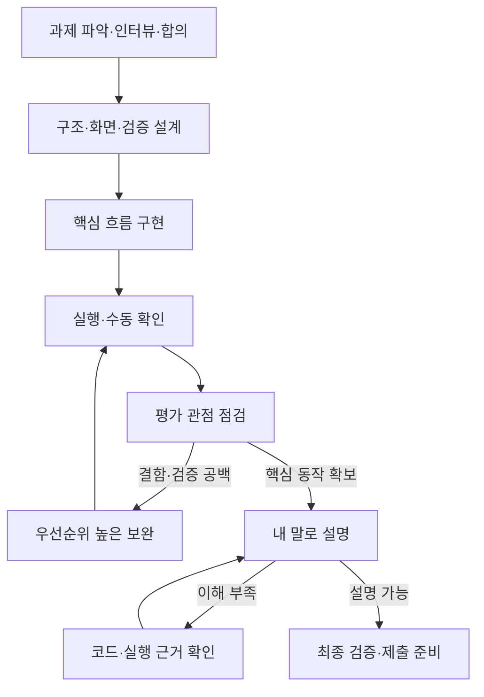

# 시험 중 요청문 선택 안내
v1.3 · 최근 두 답변의 단계별 사용법과 한눈에 보는 흐름을 통합.
이 파일부터 열고 현재 상황에 맞는 요청문 하나만 사용한다.
파일 경로는 키트 루트 기준이다. 다른 위치에 두었다면 실제 경로로 바꾼다.
자료 반입·AI 사용은 실제 시험 안내를 우선한다. 제출 후 AI 금지 서술형 단계에는 사용하지 않는다.

## 무엇을 해야 할지 모르겠다면 — 이것 하나
```text
현재 과제의 제공 지침과 runtime/WORKFLOW.md,
runtime/WORKLOG.md의 현재 상태를 먼저 확인해줘.
필요한 경우에만 관련 요구·설계·검증 항목과 실제 파일을 확인해줘.
기록이 없으면 실제 상태를 먼저 파악하고, 없는 사실을 만들어 채우지 마.

지금 상태를 과제 파악 / 인터뷰·합의 / 설계 / 구현 /
검증 / 보완 / 이해 확인 / 제출 준비 중 하나로 판단해줘.
다음으로 사용할 프롬프트 파일 하나와 이유를 짧게 알려주고,
그 지침에 따라 이미 허용된 범위의 작업을 진행해줘.
담당자 답변이나 내 직접 확인이 필요한 부분만 구분해서 알려줘.
남은 시간은 내가 제공한 값만 사용하고, 모르면 확인해줘.
```

## 현재 상황으로 고르기
| 지금 내 상황 | 아래 번호 | 사용할 파일 |
|---|---|---|
| 과제를 방금 열었다 | 1 | runtime/WORKFLOW.md |
| 중요한 업무 규칙을 모르겠다 | 2 | prompts/discovery/01_INTERVIEW.md |
| 담당자의 답변을 받았다 | 2-A → 필요하면 3 | runtime/REQUIREMENTS.md |
| 만들 범위와 완료 기준을 정해야 한다 | 3 | runtime/REQUIREMENTS.md |
| 무엇을 만들지는 알겠지만 화면·구조를 못 정했다 | 4 | prompts/ui/01_PLAN.md |
| 설계가 정해졌고 구현해야 한다 | 5 | prompts/ui/02_BUILD.md |
| 작동한다고 하는데 실제로 확인해야 한다 | 6 | prompts/ui/03_REVIEW.md |
| 어느 정도 만들었고 부족한 부분을 찾고 싶다 | 7 | prompts/review/02_GAP_REVIEW.md |
| 보완할 작업이 정해졌다 | 8 | runtime/WORKLOG.md |
| 코드를 내가 설명할 수 있는지 확인하고 싶다 | 9 | prompts/review/01_REVIEW_AND_EXPLAIN.md |
| 제출이 가까워졌다 | 10 | runtime/WORKFLOW.md · VERIFICATION.md |
| 오류가 발생했다 | 예외 A | WORKLOG.md · VERIFICATION.md |
| 세션을 바꿔야 한다 | 예외 B | runtime/HANDOFF.md |

## 진행 흐름


고정 절차를 위한 절차가 아니다. 이미 확인된 내용은 반복하지 않고 필요한 단계로 이동한다.
보완을 무한 반복하지 말고 필수 동작·중요 위험·남은 시간·제출 여유를 기준으로 종료한다.

## 1. 과제를 처음 열었을 때
```text
제공된 README, 기존 지침·자료·코드를 확인해줘.
runtime/WORKFLOW.md를 참고하되 과제 지침을 우선해줘.
업무 문제·사용자·필수 기능·제출물·완료 기준,
데이터·실행 방법·제약·중요한 미확인을 구분해줘.
확인된 요구는 출처와 함께 runtime/REQUIREMENTS.md에,
현재 상태와 다음 작업은 runtime/WORKLOG.md에 기록해줘.
아직 기능을 추측해서 추가하거나 큰 구조를 변경하지 마.
```
완료 신호: 필수 요구와 미확인이 구분됨.

## 2. 담당자에게 무엇을 물을지 정할 때
```text
prompts/discovery/01_INTERVIEW.md를 적용해줘.
자료에 답이 없는 사항 중 답변에 따라 설계·범위·판정이
달라지는 질문을 중요도순으로 우선 3개 제시해줘.
각 질문에 무엇을 결정하기 위한 것인지 붙여줘.
담당자에게 전달할 문장으로 작성하고 답변은 지어내지 마.
```
이 요청은 코딩 AI에게 한다. 실제 질문은 시나리오 담당자에게 전달한다.

### 2-A. 담당자의 실제 답변을 받은 뒤
```text
아래는 담당자의 실제 답변이야.
[실제 답변]

기존 runtime/REQUIREMENTS.md와 대조해 요구를 갱신해줘.
담당자가 말한 사실과 네 해석·가정을 구분해줘.
설계를 바꿀 중요한 미확인이 남았을 때만 후속 질문을 제시해줘.
```
완료 신호: 핵심 흐름을 설계할 정보 확보. 질문 개수를 채울 필요 없음.

## 3. 구현 범위와 완료 기준을 합의할 때
```text
확인된 요구를 바탕으로 REQUIREMENTS의 합의 요약을 작성해줘.
문제 / 병목과 근거 / 만들 것·제외할 것 /
관찰 가능한 완료 기준 / 제약·남은 미확인을 포함해줘.
담당자에게 확인할 짧은 메시지도 작성해줘.
답변을 받기 전에는 합의 완료라고 기록하지 마.
현재값이나 측정 수치가 없으면 미확인으로 남겨줘.
```
완료 신호: 중요한 업무 규칙·범위·완료 기준이 확인됨.
명확한 기존 요구나 사소한 구현 선택까지 승인을 반복하지 않는다.

## 4. 화면·구조·검증 계획을 정할 때
```text
prompts/ui/01_PLAN.md를 적용해줘.
확정된 요구를 바탕으로 최소 화면과 데이터 흐름을 설계해줘.
기존 기술 스택을 우선하고 핵심 업무가 끝까지 연결되도록 해줘.
선택과 이유는 runtime/DESIGN.md에,
완료 기준별 검증 계획은 runtime/VERIFICATION.md에,
구현 순서는 runtime/WORKLOG.md에 기록해줘.
아직 구현하지 마.
```
UI가 없는 과제: UI 프롬프트 대신 같은 요청에서 화면 설계를 제외하고 입력·처리·출력 구조를 정한다.
완료 신호: 주요 작업마다 완료 기준과 검증 방법이 연결됨.

## 5. 핵심 흐름을 구현할 때
```text
prompts/ui/02_BUILD.md를 적용해줘.
WORKLOG의 작업표에서 핵심 흐름부터 입력→처리→출력까지 구현해줘.
실제 요구 ID와 완료 기준을 따르고,
핵심 규칙·저장 처리와 화면 표시의 역할을 명확히 구분해줘.
실행 가능한 검증을 수행하고 실제 결과만 VERIFICATION에 기록해줘.
구현됨과 검증됨을 구분하고,
완료 후 대표 입력이 통과하는 실제 파일·함수를 짧게 설명해줘.
```
UI가 없는 과제: UI 프롬프트를 생략하고 WORKFLOW와 확정 설계·작업표로 구현한다.
완료 신호: 작은 핵심 흐름이 실제 데이터 처리·저장·출력까지 연결됨.

## 6. 실제 동작과 화면을 확인할 때
```text
prompts/ui/03_REVIEW.md를 적용해줘.
코드 검사와 실행 가능한 검증을 수행한 뒤,
내가 내부 브라우저에서 수동 확인할 절차와 기대 결과를 짧게 알려줘.
자동 브라우저 조작이나 화면 캡처는 요구하지 마.
내가 확인하기 전에는 수동 화면 검증 완료로 기록하지 마.
```
UI가 없는 과제: prompts/review/01_REVIEW_AND_EXPLAIN.md로 실제 출력·파일·API 등을 검증한다.
내 확인 결과는 '무엇을 했고 어떤 결과가 나왔는지'로 전달한다.
완료 신호: 정상·중요 실패 경로의 실제 결과 또는 미검증 사유가 남음.

## 7. 평가 관점으로 부족한 부분을 찾을 때
```text
prompts/review/02_GAP_REVIEW.md를 적용해줘.
prep/EVALUATION_REFERENCE.md로 현재 과제를 점검해줘.
남은 시간은 [분], 최종 확인·제출 여유는 [분]이야.
실제 코드·실행 결과·내 설명을 근거로 판정하고,
부족은 WORKLOG의 기존 작업과 병합하거나 추가해줘.
우선순위 상위 최대 3개부터 진행해줘.
공식 예상 점수는 계산하지 말고,
내 설명이 없는 인지 항목은 미확인으로 남겨줘.
```
완료 신호: 가장 중요한 부족과 다음 작업이 명확함.

## 8. 보완 작업을 진행할 때
```text
WORKLOG의 우선순위 높은 보완 작업을 진행해줘.
기존 요구와 정상 동작을 유지하고 변경 범위를 좁혀줘.
수정 후 관련 V ID를 다시 실행하고,
평가 관점 표에서 영향받은 항목만 갱신해줘.
시간이 부족하면 낮은 영향 작업은 이유와 함께 보류해줘.
```
완료 신호: 실제 재검증 근거로 상태 갱신. 새 기능 추가가 기본 해법은 아님.

## 9. 내가 코드를 이해했는지 확인할 때
```text
prompts/review/01_REVIEW_AND_EXPLAIN.md를 적용해줘.
산출물의 중요한 구조·선택 이유·실패 조건을 골라
실제 파일과 함수를 기준으로 질문 하나씩 해줘.
내 답변 전에 모범 답안을 보여주지 마.
답변을 코드와 대조해 부족한 부분을 교정하고,
이해 확인 기록에는 내가 실제로 말한 내용만 남겨줘.
```
완료 신호: 핵심 동작·선택·실패 조건을 자기 코드 기준으로 설명할 수 있음.
이미 이전 단계에서 확인한 질문을 반복하지 않는다.

## 10. 마지막 제출 준비를 할 때
```text
최종 확인·제출 준비 단계야. 새 부가 기능과 큰 구조 변경은 중단해줘.
제출 지침과 REQUIREMENTS를 대조하고,
필수 요구별 최종 구현 위치·검증 상태를 확인해줘.
마지막 변경이 영향을 준 핵심 검증을 다시 실행하고,
실행 명령·필수 파일·출력 형식·저장 및 재조회를 확인해줘.
문서와 코드의 불일치를 수정하고 실패·미검증·한계를 정리해줘.
제출 위치·파일·실행 방법·남은 위험을 짧게 알려줘.
플랫폼 제출 결과를 확인하기 전에는 제출 완료라고 기록하지 마.
```
키트 전체가 필수 제출물이라는 뜻이 아니다. 과제 지침대로 제출한다.

## 예외 A. 오류가 발생했을 때
```text
아래 오류의 재현 조건과 원인을 먼저 확인해줘.
[내가 수행한 행동과 실제 오류]
추정과 확인된 원인을 구분하고 최소 범위로 수정해줘.
같은 조건으로 재검증한 결과는 VERIFICATION에,
원인·수정 범위·검증 ID는 WORKLOG에 기록해줘.
```

## 예외 B. 세션을 바꿔야 할 때
기존 세션:
```text
세션을 전환하려고 해. runtime/HANDOFF.md에
현재 요구·결정·변경 파일·실행 방법·검증 상태,
남은 시간·다음 작업·중요한 미확인을 정리해줘.
다른 문서는 ID로 참조해줘.
```
새 세션:
```text
제공 지침과 runtime/WORKFLOW.md, runtime/HANDOFF.md를 읽어줘.
인계 기록과 실제 파일 상태를 대조한 뒤,
관련 문서만 추가로 읽고 다음 우선순위 작업부터 이어가줘.
```

## 파일 역할
| 위치 | 의미 |
|---|---|
| START_HERE.md | 전체 안내 |
| prep/ | 사전 준비·평가 관점 참고 |
| prompts/ | 현재 작업을 시작하는 지침 |
| runtime/REQUIREMENTS.md | 요구·담당자 답변·합의·가정 |
| runtime/DESIGN.md | 구조·화면·선택 이유 |
| runtime/VERIFICATION.md | 기대 결과·실제 실행 근거 |
| runtime/WORKLOG.md | 작업·오류·평가 점검·내 설명 |
| runtime/HANDOFF.md | 필요할 때만 세션 인계 |

## 인터뷰 연습 서비스 예시 — 실제 요구 아님
가정: 텍스트 답변, 팀장의 수동 피드백, 저장·재조회가 합의되었고 음성·자동 채점은 제외된 경우.
핵심 흐름: 질문 조회 → 선수 답변 제출 → 팀장 조회 → 피드백 저장 → 재조회.
질문 예: 최근 실패 사례는? 누가 무엇을 평가하는가? 누가 기록을 조회하는가?
검증 예: 답변·질문 연결, 다른 답변의 피드백 혼입 방지, 빈 답변 처리, 저장 실패 안내, 재조회.
이해 질문 예: 답변과 피드백을 무엇으로 연결했는가? 저장 실패는 어디서 감지하는가?
실제 과제에서 음성·자동 평가 등이 필수라면 이 가정을 그대로 적용하지 않는다.

